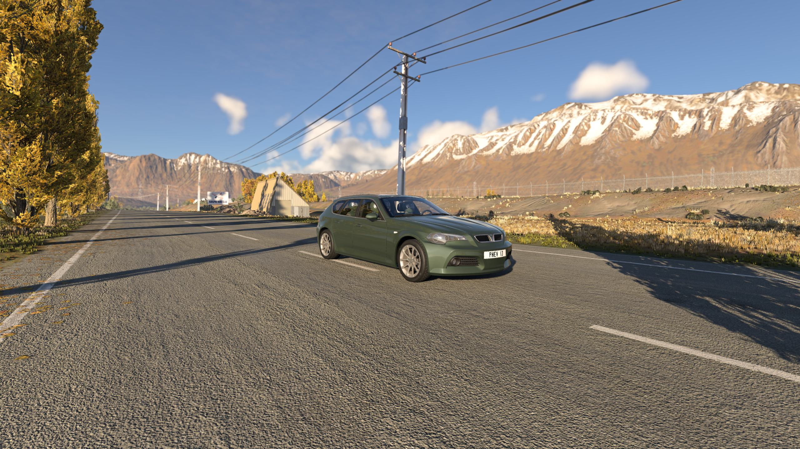
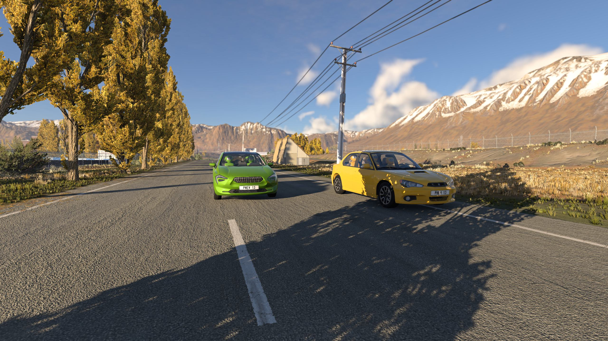
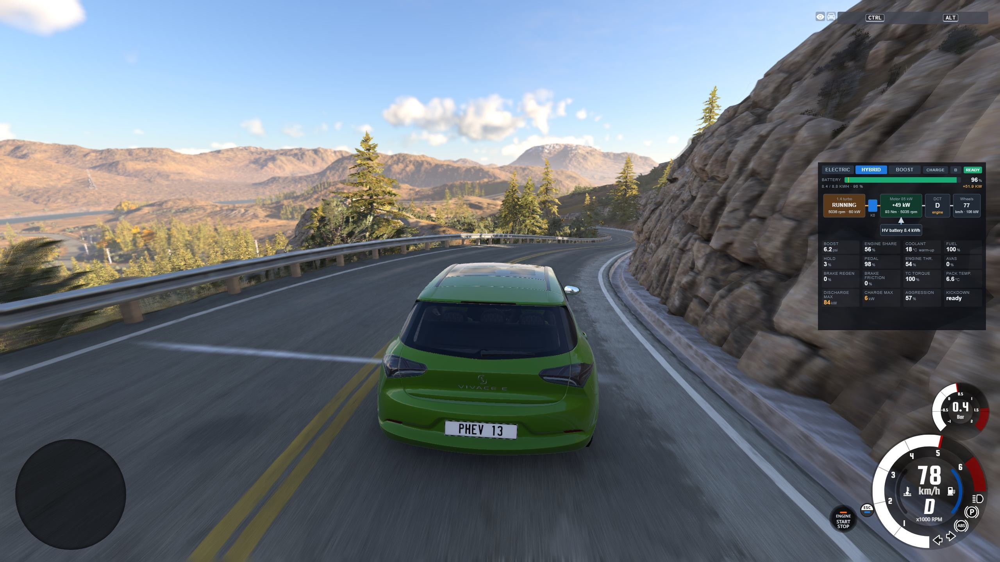
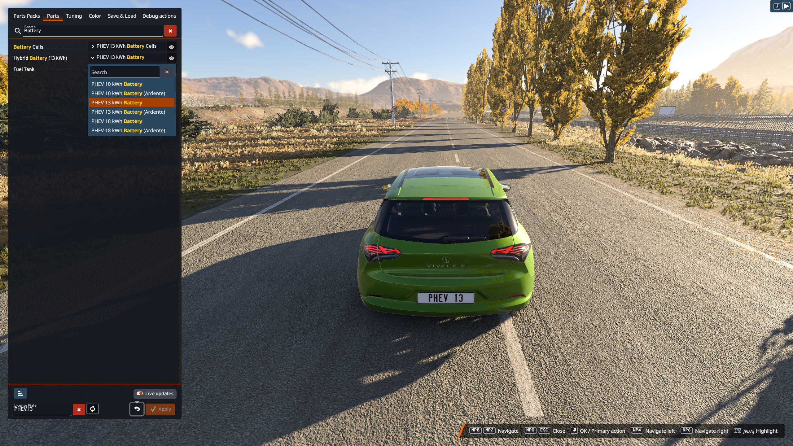

# Plug-in Hybrid Swap for BeamNG.drive

A plug-in hybrid drivetrain for five of the game's cars: a 1.4 litre turbo petrol engine (115 kW) and an 85 kW electric motor between the engine and a 6-speed dual-clutch gearbox, with a clutch that lets the engine stop and start while you drive. The battery sits under the rear seat (behind the front seats in the coupe); the petrol tank stays (smaller, to make room for the pack).

The drivetrain is calibrated on measurements of a real plug-in hybrid estate car: drive logs, the workshop manual and published data. Engine start and stop, the torque split, regeneration, brake blending and the warm-up all follow what that car does.









Mod id: `plugin_hybrid_swap` (zip name `plugin_hybrid_swap.zip`, unchanged between versions).

## Cars and configurations

The mod adds new configurations to vanilla cars. It uses their vanilla meshes; the battery box is hidden in the rear seat base (behind the front seats in the K-Series coupe).

| Car | Configurations | Drive |
|---|---|---|
| ETK 800-Series | `PHEV_ETK_wagon`, `PHEV_ETK_sedan` | rear-wheel drive |
| ETK K-Series | `PHEV_ETKC_coupe` | rear-wheel drive |
| Cherrier Vivace | `PHEV_FCV` | front-wheel drive |
| Cherrier Ardente | `PHEV_Ardente` | front-wheel drive |
| Hirochi Sunburst | `PHEV_Sunburst` (sedan), `PHEV_Sunburst_wagon` | front-wheel drive |

## Features

- Three drive modes: Electric (engine off), Hybrid (the car decides) and Boost (engine and motor together, full system power).
- Charge mode: in Hybrid the engine charges the battery while you drive or stand still, up to the top of the usable window, then it holds. Standing still in P or N the engine runs at about 1,800 rpm and charges about 11 kW; in D at a standstill about 2 kW, without creeping.
- Regeneration when you lift off and when you brake, blended with the friction brakes. B position for stronger lift-off regeneration.
- Kickdown at full pedal (99 %); with keyboard throttle, hold full throttle for 2 s. It can be switched off.
- Battery sizes of 10, 13 and 18 kWh in the parts selector, each with its own mass. The petrol tank is reduced for the battery (38 L at 13 kWh).
- Battery management: the usable window is 22.5-90 % of the pack. The charge never goes above the top of it, whatever charges it (regeneration, the engine, a career charging station: the charger stops there and bills only the energy the pack took).
- Battery temperature: the pack starts at 20 °C with the game's "start preheated" setting, otherwise 5 °C above the outside temperature. A cold or hot pack gives and takes less power.
- Traction control follows the drive mode: Electric and Hybrid keep wheel slip low, Boost allows more.
- Brakes and springs are adjusted per car for the extra mass, so the car keeps its ride height and brakes at least as strongly as before at the same pedal. Lifting off coasts more freely than with engine braking: regeneration takes its place (see [docs/PHEV-TUNING.md](docs/PHEV-TUNING.md)).
- Brake torque vectoring on the inner front wheel (rear-wheel-drive configurations have it off by default).
- Emergency stop signal: the brake lights flash under full braking from high speed, the hazard lights come on near a standstill.
- No engine start while the engine's air intake is under water.
- Plug-in Hybrid Monitor UI app: drive mode, engine and clutch state, motor and battery power, charge level. It shows only on a car with this drivetrain.

## Install

1. Put `plugin_hybrid_swap.zip` in your BeamNG.drive `mods` folder (or subscribe to it on the official repository) and start the game.
2. Spawn one of the PHEV configurations listed above, or fit the parts to a configuration of your own (engine, gearbox, hybrid module, battery) in the parts selector.
3. In the UI apps menu, add **Plug-in Hybrid Monitor** if you like.

### Building the zip from this repository

The `mod/` folder is the content of the zip. Zip its contents, so that `lua/`, `ui/` and `vehicles/` are at the top level of the archive (not inside a `mod/` folder):

```
cd mod
zip -r ../plugin_hybrid_swap.zip .
```

The mod ships shared Lua under `lua/vehicle/...` (controller, powertrain device, shift logic). If your game version does not find it there, copy the three Lua files into each car's own `vehicles/<car>/lua/` folder instead and remove them from `lua/vehicle/`; do not keep both.

## Keys

Change them in Options > Controls, category vehicle.

| Key | Action |
|---|---|
| G | Electric mode on / off |
| T | Boost mode on / off |
| U | B position (stronger lift-off regeneration) |
| K | Kickdown on / off |
| (none) | Next drive mode, Charge mode: bind them if you want them |

## The monitor app

"Plug-in Hybrid Monitor" (`ui/modules/apps/PhevMonitor`) reads the `phev*` electrics of the active vehicle and shows drive mode, engine and K0 clutch state, motor and battery power and the charge level. It hides itself on any vehicle that does not publish `phevMode`.

## For mod authors

The hybrid parts and Lua are shared, so other vehicle mods can use them with a few small adapter parts and list this mod as a requirement. The guide is [docs/PHEV-ADAPTER.md](docs/PHEV-ADAPTER.md).

## Documentation

| Document | Content |
|---|---|
| [docs/PHEV-ADAPTER.md](docs/PHEV-ADAPTER.md) | How a car mod uses the shared parts |
| [docs/PHEV-TUNING.md](docs/PHEV-TUNING.md) | Per-car tuning: mass, brakes, springs, battery sizes, petrol tank |
| [docs/PHEV-MESHES.md](docs/PHEV-MESHES.md) | The battery box mesh and its clearance to the vanilla car |
| [docs/PHEV-VALUES.md](docs/PHEV-VALUES.md) | Where the core data values come from |
| [docs/TECHNICAL.md](docs/TECHNICAL.md) | How the drivetrain works, and how it compares with a real car of the same layout (charts) |

## Repository layout

```
mod/        the mod, exactly the content of the zip
docs/       documentation
LICENSE     MIT
```

## Credits and licence

Plug-in Hybrid Swap is by mcheijink, released under the MIT licence (see [LICENSE](LICENSE)). It needs BeamNG.drive and uses the game's vanilla cars, meshes and materials; it contains no copied vehicle meshes or textures. The ETK, K-Series, Cherrier and Hirochi cars are BeamNG's own.

### NOTICE

`mod/lua/vehicle/controller/shiftLogic-phevDct.lua` is a modified copy of BeamNG's dual-clutch shift logic. It is licensed under the BeamNG Common Development and Distribution License (bCDDL) version 1.1, not under the MIT licence. Its header is kept; the changes are marked in the file with `PHEV:`. The licence text is at <http://beamng.com/bCDDL-1.1.txt>. The part files list "BeamNG" as author where they reuse stock values of the game's own parts.

All other files in this repository are under the MIT licence.
