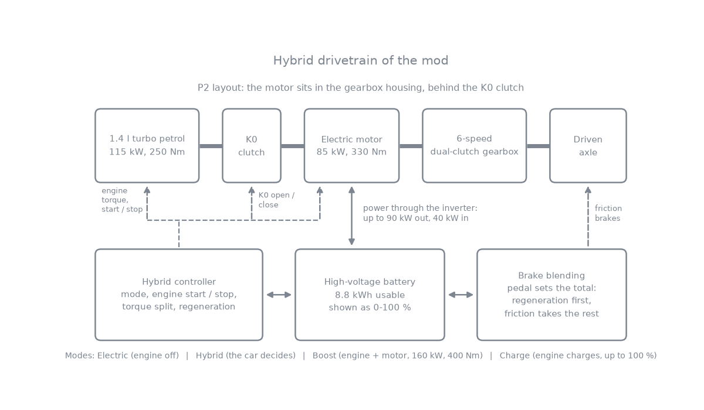
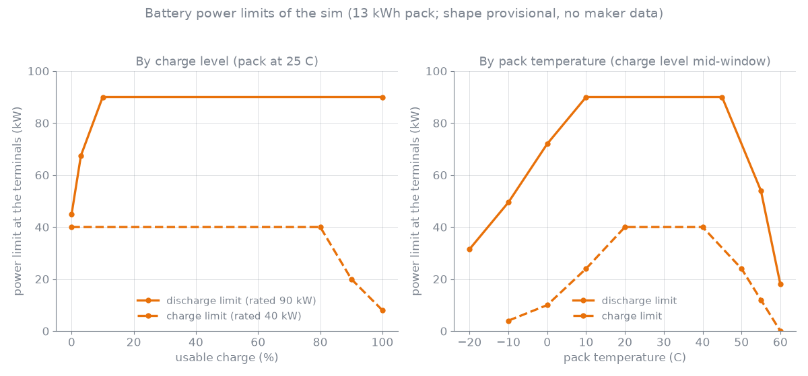
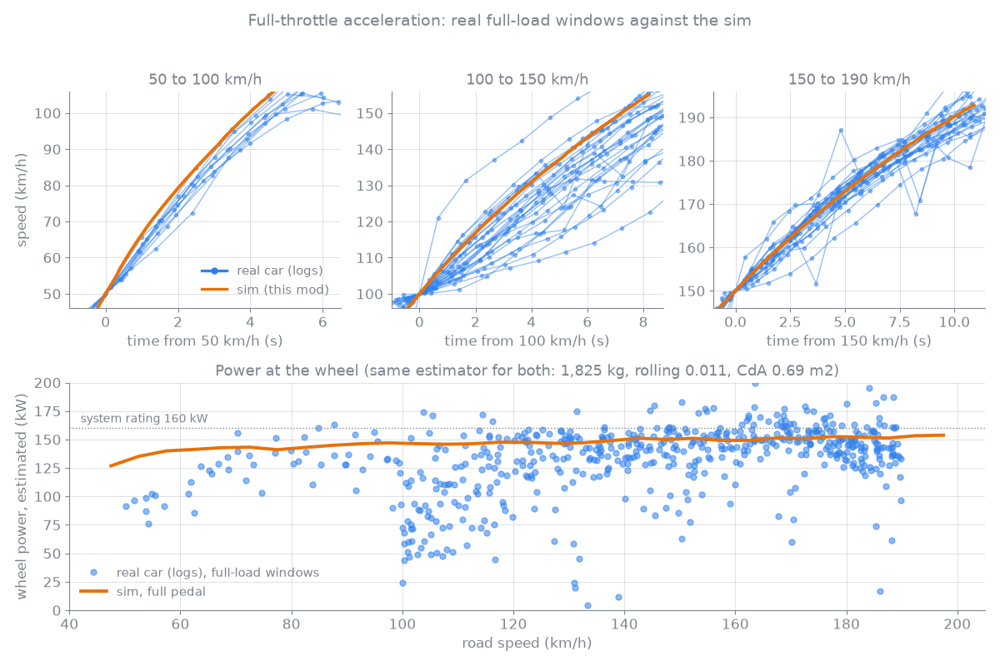
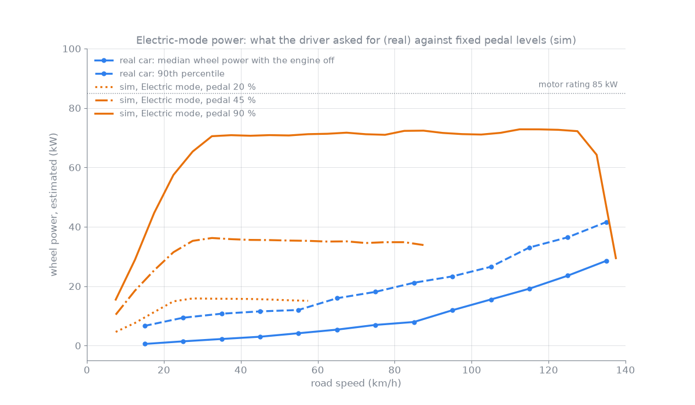
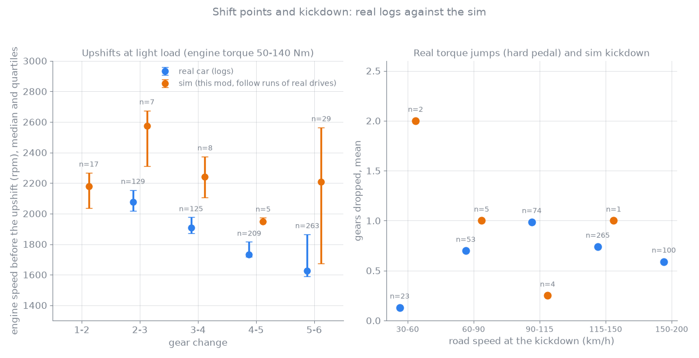
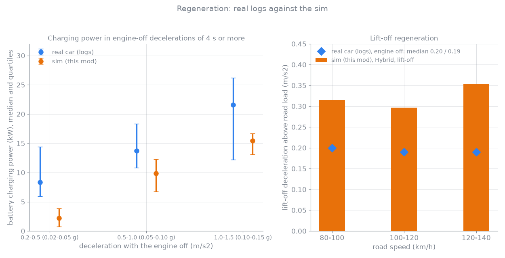
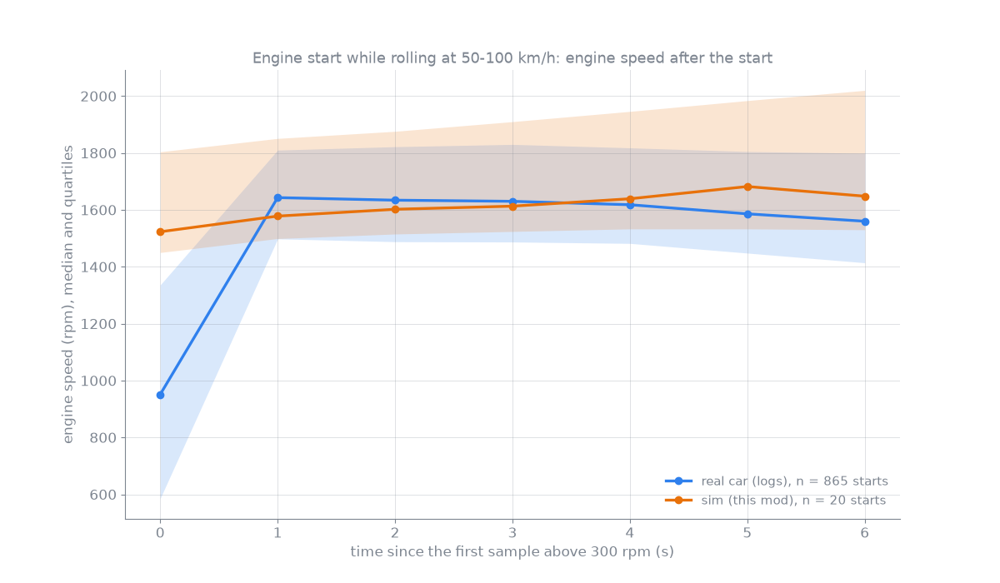
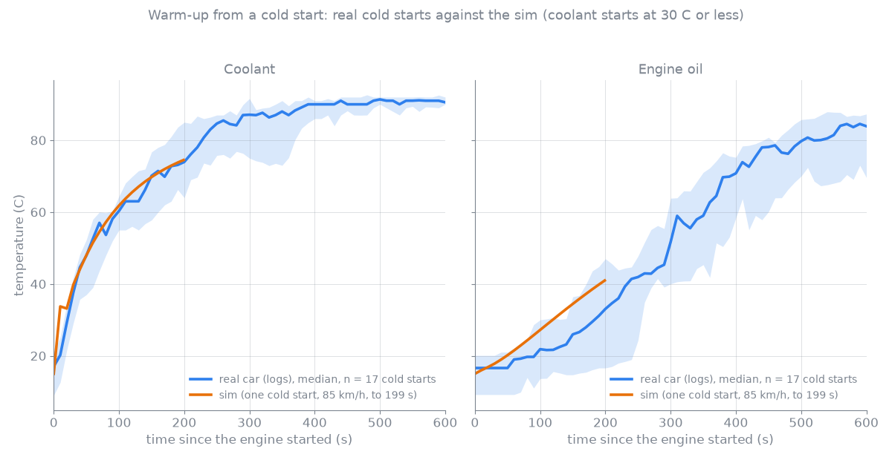
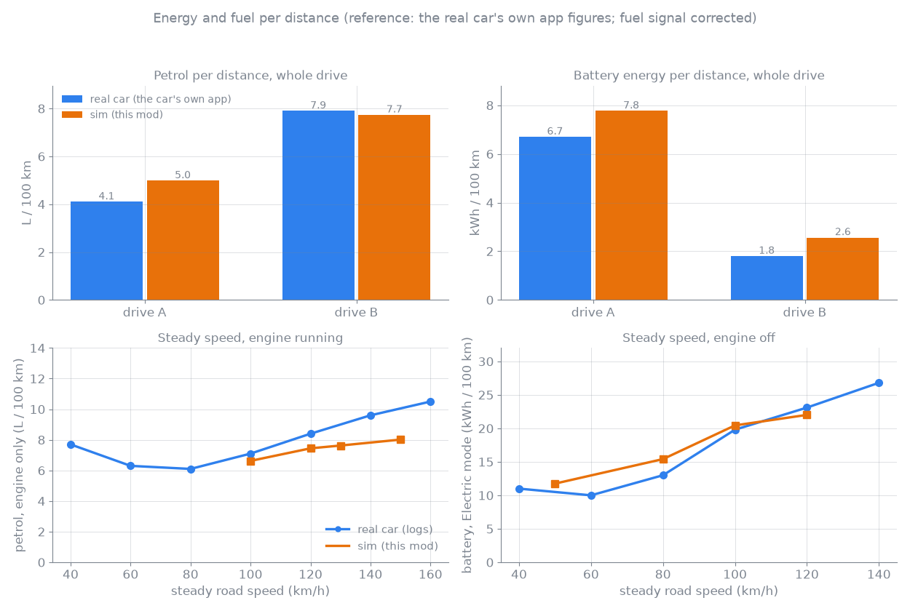
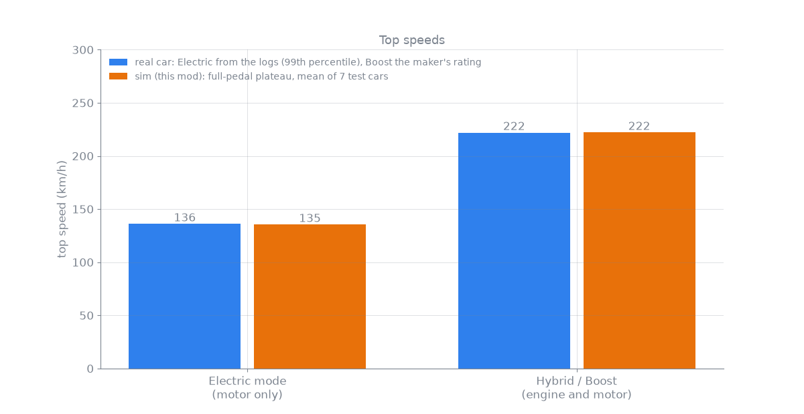

# Plug-in Hybrid Swap: technical details

This document describes how the drivetrain of the mod is built and how it compares with a real production plug-in hybrid with the same drivetrain layout (1.4 l turbo petrol, 85 kW motor in the gearbox housing, 6-speed dual-clutch). That car is called "the reference car" below. The mod was calibrated on its drive logs, its published data and its measured mass; this document puts the real numbers next to the numbers the sim produces for the same manoeuvre, and says where they differ.

Other documents: [PHEV-TUNING.md](PHEV-TUNING.md) (per-car mass, brakes, springs, battery sizes), [PHEV-VALUES.md](PHEV-VALUES.md) (where the core values come from), [PHEV-ADAPTER.md](PHEV-ADAPTER.md) (using the parts in another car mod).

Reading the charts and tables:

- In every chart the real car is **blue** and the sim is **orange**. Charts have one y-axis each; the multi-panel charts have separate panels, never a second axis.
- "Difference" is always sim minus real, in the unit of the row and in percent of the real value.
- "Real" comes from the reference car's drive logs (OBD data, 1 Hz), from the car's own app trip figures, or from published data; each table says which. All drive logs are used only in aggregated form: no positions, routes, places or dates are used anywhere in this document.
- "Sim" comes from the mod's own test runs in the game on a flat empty map, and from follow runs, in which the sim drives the speed trace of a real drive (drive A and drive B below). The sim runs were made with the shared hybrid module and controller fitted to a passenger-car body with the reference car's mass (1,770 kg without driver) and gear ratios. Some runs were made before the last tuning steps of the launch torque, the turbo and the warm-up; each topic says if that matters. The follow runs of drives A and B were made before the last tuning steps of the driving-style shift index, the standstill charge, the charge cap and the top-speed limiter.

## 1. Architecture

### 1.1 The P2 layout

The torque path is: 1.4 l turbo petrol engine, the K0 disconnect clutch, the electric motor, the 6-speed dual-clutch gearbox (clutches K1 and K2), the front axle. The motor sits behind K0, so it can drive the car alone with the engine stopped and decoupled, drive together with the engine, work as starter and as generator.

| Item | Value |
|---|---|
| Engine | 1.4 l turbo petrol, 115 kW at 5,000 rpm, 250 Nm from 1,500 to 3,500 rpm, idle 800 rpm, limiter 6,000 rpm |
| Motor | 85 kW peak, 330 Nm up to about 2,460 rpm, then constant power, 7,000 rpm maximum |
| System | 160 kW and 400 Nm at the gearbox input (engine plus motor are limited to this) |
| First gear | engine plus motor at most 220 Nm at the gearbox input (provisional, see 4) |
| Gearbox | 6 forward gears, overall ratios (with the 3.75 final drive) 13.13, 8.00, 5.34, 3.83, 2.94, 2.42 |
| Battery | 13 kWh gross (10 and 18 kWh in the parts selector), 96 cells in series, usable window 22.5 to 90 % |
| Auxiliaries | 0.7 kW taken from the high-voltage battery while the system is on |
| Top speed | 222 km/h; Electric mode 137 km/h (true speed) |

The hybrid module takes over the game's engine lookup, so the vehicle controller, the gauges and the shift logic talk to one "engine" whose speed is the input-shaft speed, whose torque curve is the combined system curve, and whose temperatures are those of the real engine model. K0 is a spring-damper clutch with a torque limit set by the controller. The motor torque is limited by its torque curve, by the battery's discharge and charge limits at the terminals, and by the system limit (400 Nm, 160 kW). Motor and inverter losses come from a generic permanent-magnet loss map (constant inverter loss, a term proportional to torque, copper loss proportional to torque squared, iron loss that grows with speed, field weakening above 4,500 rpm, and a spin loss that drags whatever turns the shaft).

### 1.2 Drive modes and engine start and stop

The strategy runs at physics rate in the vehicle controller. Four modes exist; the real car's mode names map to them (its electric-only mode to Electric, its automatic hybrid mode to Hybrid, its sport mode to Boost, its battery-charge function to Charge mode).

| | Electric | Hybrid | Boost | Charge mode |
|---|---|---|---|---|
| Engine | off, K0 open | engine-led; starts on requested power, stops when the load falls away | joins eagerly, stays on longer after lift-off | as Hybrid, but held on while the charge is below target |
| Pedal | share of the best wheel torque the motor can give at this speed (up to 85 kW); kickdown gives the motor's full power | pedal times the engine's full-load torque; the engine alone up to 130 Nm, the motor fills half of the demand above that; kickdown gives the full system | pedal times system torque (400 Nm, 160 kW); the engine takes its part up to full load, the motor adds above, faded in with the pedal squared up to kickdown | engine torque target is the demand plus a charging torque (about 60 Nm while driving, tapering over the last 5 % before the target) |
| Lift-off | 0.03 g regeneration plus electric creep | 0.03 g including the drag of a coupled engine | 0.04 g including engine drag | unchanged |
| Top speed | 137 km/h true; the motor power tapers to zero over the last 3 km/h up to the limit, so the car only exceeds it downhill | 222 km/h, also with kickdown | 222 km/h | – |
| Switches by itself | only an empty battery moves the car to Hybrid (kickdown does not) | – | holds the charge at half of the usable window: the engine charges below that | charges up to the top of the usable window, then holds |

**When the engine starts (Hybrid and Boost).** The strategy computes the requested wheel power, the pedal times what the drivetrain can deliver right now at this shaft speed. The engine starts when that exceeds a speed-dependent threshold, on kickdown (pedal at 99 %), when the charge is below the hold target, or above 130 km/h in Hybrid while the driver is pulling. It stops again when the request falls below half the threshold, and on lift-off after a delay that grows with speed.

| Road speed | 0 | 50 | 70 | 100 | 120 | 140 | 160 km/h |
|---|---|---|---|---|---|---|---|
| Hybrid: engine starts above | 13 | 14 | 15 | 24 | 32 | 40 | 45 kW |
| Boost: engine starts above | 6.5 | 7 | 7.5 | 12 | 16 | 20 | 22.5 kW |

Delay between lift-off (or braking) and the engine stopping, by road speed:

| Hybrid, road speed | 0 | 60 | 100 | 140 | 180 km/h |
|---|---|---|---|---|---|
| Engine stops after | 1.0 | 1.2 | 2.5 | 4.5 | 5.5 s |

| Boost, road speed | 0 | 60 | 100 | 130 | 150 | 180 km/h |
|---|---|---|---|---|---|---|
| Engine stops after | 1.0 | 1.8 | 3.0 | 4.5 | 12 | 14 s |

The engine runs at least 1 s once started and stays off at least 0.5 s. A cold engine keeps running until the coolant reaches 70 °C: below 50 °C it never stops, from 50 to 70 °C it may stop below 10 km/h or at a standstill, and once the engine has been warm it never restarts just to keep warm. While cold, its torque is limited (about 55 % of full load below 40 °C, full load from 80 °C) and the motor fills the rest. Pulling away is electric: a stopped engine starts only when the shaft turns fast enough for engine idle in the current gear (about 8 km/h in first gear), or on kickdown.

**Charge mode.** The engine charges up to the top of the usable window, then the car holds. The pack takes less and less over the last per cent, so charging stops at about 99.5 % of the usable charge and starts again below about 98.5 %; standing still the charging torque also falls to 30 % over the last 5 % before that. Standing still in P or N the engine idles at about 1,800 rpm and the motor generates 60 Nm (about 11 kW); in D with the brake held the engine keeps its idle and the motor generates 25 Nm (about 2 kW), so the car does not creep. Hybrid itself only holds a small reserve (about 3 % of the window): it uses the battery to save fuel instead of holding the charge it had when selected.

**Engine start sequence (K0 sync).** The stop and start of the engine goes through a small state machine:

1. **Off:** K0 open, ignition off.
2. **Crank:** K0 closes partly (about 80 Nm). The motor drags the engine up and supplies that torque as well, so the wheels do not feel it. There is no starter motor.
3. **Sync:** once the engine fires above 600 rpm, K0 opens and the engine's idle controller revs it to the shaft speed. That controller is proportional only, so the target leads the shaft by 50 rpm and an integral trim removes the rest; K0 closes anyway after 1 s and slips the difference.
4. **Close:** within 40 rpm of the shaft speed K0 ramps closed over 0.25 s.
5. **Running:** engine and motor drive together.
6. **Stop:** K0 ramps open over 0.15 s, the ignition goes off, the engine spins down.

A start that does not fire within 2 s, or an engine that dies during sync, is retried after 5 s.

**Gearbox.** The shift logic is a modified copy of the game's dual-clutch logic: upshifts hand over in a torque phase and a synchronised inertia phase (the engine's torque is reduced through its torque limit so the motor does not have to absorb it), downshifts let the engine blip through its idle controller within a 12 kW motor speed-match, and in Electric mode the shift points are the motor's. Kickdown picks a target gear (the highest gear that still gives at least 65 % of the best gear's wheel force, up to 5,600 rpm), and a slow driving-style index raises the light-load upshift points up to half-way to the full-load points. The full-load upshift is capped at 5,200 rpm.

### 1.3 The battery model

| Item | Model |
|---|---|
| Capacity and window | 13 kWh gross; usable window 22.5 to 90 % of the pack, 8.775 kWh (10 kWh pack 6.75 kWh, 18 kWh pack 12.15 kWh usable). The displayed charge runs 0 to 100 % over the window: the monitor app and every charge figure in this document use this usable scale; raw values (share of the whole pack) are marked as such |
| Cap at the top | the stored energy is clamped at the top of the window (100 % usable; raw: 90 % of the pack) whatever charges the pack: regeneration, the engine, or a career charging station (the station stops there and bills only what the pack took; its own screen is the game's and counts from an empty pack, so it shows 11.7 kWh at the top of the 13 kWh pack). Charge limits also taper well before the top |
| Rated power | 90 kW out and 40 kW in at the terminals (13 kWh pack) |
| Discharge limit by charge | 50 % of rated at 0 % usable, 75 % at 3 %, full from 10 % |
| Charge limit by charge | full up to 80 % usable, 50 % at 90 %, 20 % at 100 % |
| Temperature derating | discharge 35 / 55 / 80 / 100 % at -20 / -10 / 0 / 10 °C, full up to 45 °C, 60 % at 55 °C, 20 % at 60 °C; charge 10 / 25 / 60 / 100 % at -10 / 0 / 10 / 20 °C, full up to 40 °C, 60 % at 50 °C, 30 % at 55 °C, 0 at 60 °C |
| Cell voltage limits | 3.0 V and 4.2 V per cell, with the internal resistance rising 3.5 % per kelvin below 25 °C (2.4 times at 0 °C) |
| Internal resistance | 0.13 ohm for the 13 kWh pack (assumed, see 4); the loss heats the pack |
| Pack temperature | one lumped thermal mass, cooled through the housing, the coolant circuit from 25 °C and a chiller between 32 and 38 °C |
| Preheat setting | with the game's "start preheated" setting the pack starts at 20 °C, otherwise at 5 °C above the outside temperature |
| Auxiliaries | 0.7 kW from the battery while the system is on |

The chart is drawn from the shipped part data. It is a model, not a measurement: the real car's battery management is not published, so the shape (the 80 % charge knee, the temperature maps) is a generic one for liquid-cooled plug-in hybrid packs, fitted to what the logs show (regeneration falls away at high charge and in the cold).

### 1.4 Regeneration and brake blending

- **Limits.** Regeneration is limited by the motor's generator torque at its current speed (330 Nm up to about 2,460 rpm, then 85 kW), by 40 kW into the battery, and by the battery's charge limit. There is no separate deceleration cap.
- **Lift-off.** A lift-off deceleration target, not a fixed torque, so it feels the same at every speed: 0.03 g in Electric and Hybrid, 0.04 g in Boost, 0.14 g in the B position. The target includes the drag of a coupled engine; the motor regenerates what that drag leaves. This is lighter than the engine braking of a conventional car by design.
- **Blending (series, regeneration first).** The brake pedal sets the *total* braking: pedal times the car's total friction brake torque, computed per wheel as the game does it, so the pedal feel does not change. The motor takes as much of that total as it can, converted to wheel torque through the current gear. The friction brakes get the remainder, lowered evenly on all four wheels, like an electric brake servo that lowers the pressure of the whole system. Regeneration only brakes the driven axle, so the balance moves forward while regenerating.
- **Hand-over.** Full regeneration above 10 km/h, fading to none at 5 km/h, then friction only. Friction also takes over by itself with a full battery and while ABS, traction control or ESC intervene. A front-wheel slip watch compares the driven wheels with the ground speed and cuts regeneration when a wheel is more than 15 % slower.
- **Brake lights** come on from a regenerative deceleration of 1.0 m/s2 and go off below 0.7 m/s2; an emergency stop signal flashes them at 4 Hz from 80 km/h at 6 m/s2.

## 2. Real against sim

Each topic gives one chart, a table of real, sim and difference, and the known gaps. A topic without a matching real measurement says so instead of showing a chart.

### 2.1 Full-throttle acceleration and power at the wheel

The top row shows the speed against the time from the lower speed of each segment: every thin blue line is one real acceleration in the logs in which the engine ran at about full torque (mean indicated torque of 200 Nm or more); the orange line is the sim at full pedal in Boost mode. The bottom panel shows the power at the wheel, estimated from the speed trace with the same formula for both (1,825 kg, rolling coefficient 0.011, drag area 0.69 m2).

| Quantity | Real | Sim | Difference |
|---|---|---|---|
| 0 to 100 km/h, standing start | 7.6 s (published) | 7.37 s | -0.23 s (-3 %) |
| 0 to 180 km/h | 22.7 s (test-car figure) | 20.55 s, earlier build, not re-measured | -2.2 s (-10 %); about -1.2 s if the +0.9 s that the first-gear limit added to 0 to 100 carries over (estimate) |
| 50 to 100 km/h | median 4.53 s, 10th to 90th percentile 4.12 to 4.90 s (n = 11 windows); fastest logged 4.0 s | 3.97 s | -0.56 s (-12 %) against the median, -0.15 s against the 10th percentile |
| 100 to 150 km/h | median 8.58 s, 7.17 to 11.13 s (n = 29) | 7.22 s | -1.36 s (-16 %); +0.05 s against the 10th percentile |
| 150 to 190 km/h | median 10.53 s, 9.17 to 12.14 s (n = 26) | 9.93 s | -0.60 s (-6 %); +0.76 s against the 10th percentile |
| Wheel power 50 to 100 km/h, median | 128 kW (quartiles 104 to 136) | 143 kW | +15 kW (+12 %) |
| Wheel power 100 to 150 km/h, median | 133 kW (103 to 149) | 148 kW | +15 kW (+11 %) |
| Wheel power 150 to 190 km/h, median | 148 kW (136 to 158) | 151 kW | +3 kW (+2 %) |
| System rating | 160 kW, 400 Nm (published) | 157.7 to 157.9 kW median in Boost, 40 to 160 km/h, on 7 test cars | -2 kW (-1 %) |

Known gaps:

- The sim is full pedal, Boost, every time. The logs have no pedal signal for these windows, so the real windows are only known to have the engine at full torque; the motor's share, the mode and the road gradient are not. That is why the real median is slower than the sim and the sim matches the fast end (10th percentile) of the real windows.
- The 0 to 100 km/h time of 7.37 s, the 0 to 180 km/h time and the 157.7 to 157.9 kW system median in the table are from sim runs made before the last engine retune. A later retest on seven other bodies (other masses and drag areas) gave 0 to 100 km/h in 6.25 to 7.11 s counted from the engine start, which is 0.6 to 0.76 s after the pedal; those bodies are not the reference car's mass, so the figures are not directly comparable with the 7.37 s.
- The 0 to 100 and 0 to 180 figures for the real car are published or test-car figures with a driver on board; the sim has no driver (1,770 kg).
- The standing-start sim run uses the current first-gear torque limit (220 Nm), which is a calibration to the published 0 to 100 time, so that match is by construction. The 0 to 180 run is from before that limit.
- The speed trace has 1 Hz resolution, so single power samples are noisy (the scatter at 100 to 150 km/h). The medians are the usable numbers.

### 2.2 Electric-mode power

| Quantity | Real | Sim | Difference |
|---|---|---|---|
| Motor peak at full pedal | 85 kW (published) | 85.0 kW (reached from about 27 km/h and held) | 0 |
| Wheel power at full pedal, mean 2 to 10 s | not logged | 81.0 kW | – |
| Battery power at full pedal, mean 2 to 10 s | not logged (published peak 85 kW) | 89.6 kW (motor efficiency about 94 %) | – |
| Wheel power at 55 km/h | median 4.2 kW, 90th percentile 12.0 kW | pedal 20 %: 15 kW, 45 %: 35 kW, 90 %: 71 kW | no common pedal position |
| Wheel power at 95 km/h | median 11.9 kW, 90th percentile 23.3 kW | pedal 90 %: 71 kW | no common pedal position |
| Wheel power at 115 km/h | median 19.2 kW, 90th percentile 33.0 kW | pedal 90 %: 73 kW (the 45 % run, about 35 kW, only reaches 90 km/h) | no common pedal position |
| Electric top speed | see 2.8 | see 2.8 | |

The real values are what the driver asked for with the engine off; the logs have no pedal and no full-pedal Electric pull, so they cannot confirm the 85 kW. What they show: the real 90th percentile (12 to 18 kW at 55 to 75 km/h, 33 kW at 115 km/h) sits at about the sim's 20 % pedal (15 kW) at town speeds and about its 45 % pedal (about 35 kW) at 100 to 135 km/h. The full-pedal figures (85.0 kW motor, 81 kW wheel) come from the sim's test run and the published rating only.

Known gaps: no real full-pedal Electric data exists in the logs (the logs are from everyday driving), so the full-power row compares the sim with the published rating only. The sim pedal map is "share of the best wheel torque at this speed", not a measured map of the real car.

### 2.3 Shift points and kickdown

The gear of the real car is derived from engine speed divided by road speed (the ratio per gear is known from the logs); the upshift events are the changes from gear n to gear n+1 with the gear steady for three samples before and after. Light load means indicated engine torque of 50 to 140 Nm. The sim events come from the follow runs of drives A and B, with the same event definition on the sim's 1 Hz samples.

| Upshift at light load | Real engine speed before the shift (median, events) | Sim (median, events) | Difference |
|---|---|---|---|
| 1 to 2 | not in the logs (the engine is rarely on in first gear) | 2,178 rpm (17) | – |
| 2 to 3 | 2,075 rpm (129) | 2,573 rpm (7) | +498 rpm (+24 %) |
| 3 to 4 | 1,908 rpm (125) | 2,241 rpm (8) | +333 rpm (+17 %) |
| 4 to 5 | 1,732 rpm (209) | 1,948 rpm (5) | +216 rpm (+12 %) |
| 5 to 6 | 1,625 rpm (263) | 2,207 rpm (29) | +582 rpm (+36 %) |
| Full-load upshift | median about 4,680 rpm (4 to 5 at 235 Nm; analysis of the logs) | 5,190 rpm (1 to 2 and 2 to 3; 5,520 rpm in two 3 to 4 events), capped at 5,200 rpm | +510 rpm (+11 %) |

| Kickdown, gears dropped (mean, events) | Real (hard-pedal torque jumps) | Sim (pedal at 99 %) |
|---|---|---|
| 30 to 60 km/h | 0.13 (23) | 2.0 (2) |
| 60 to 90 km/h | 0.70 (53) | 1.0 (5) |
| 90 to 115 km/h | 0.99 (74) | 0.25 (4) |
| 115 to 150 km/h | 0.74 (265) | 1.0 (1) |
| 150 to 200 km/h | 0.59 (100) | no event |

Known gaps:

- At moderate load the sim upshifts later (at higher engine speed) than the real car, by 200 to 600 rpm. The light-load shift points shipped with the mod (2,050 / 1,900 / 1,720 / 1,600 rpm for 2 to 3 up to 5 to 6) are close to the 25th percentiles of the logged light-load upshifts in this sample (2,018 / 1,872 / 1,716 / 1,590 rpm), rounded up. The follow runs hold a moderate pedal that, most likely, moves the points part of the way to the full-load points more than the real car does. This is the largest open gap in the shift behaviour.
- At full load the real car shifts up earlier than the sim's 5,200 rpm cap. The real full-load number (about 4,680 rpm) comes from a single row of an earlier analysis of the logs, not from the sample set above: at 1 Hz the engine speed just before a fast shift cannot be read exactly, so this document does not give a measured full-load number for the real car.
- The kickdown comparison is weak. The logs have no pedal in most drives, so the real "kickdown" events are torque jumps from under 120 Nm to over 210 Nm within three seconds, which includes brisk but not full pedal. The sim's kickdown events are few (12 in total) and span different speeds and gears. The one clear difference is that the real car often does not drop a gear at all in a torque jump at 30 to 60 km/h, while a kickdown at full pedal does in the sim.

### 2.4 Regeneration and blending

The left panel takes every engine-off deceleration of 4 s or more in which the battery charge visibly rose, and divides the energy from the charge signal by the duration. The signal moves in steps of about 51 Wh, so single events are coarse. The right panel shows the sim's lift-off deceleration with the engine off, above the road-load deceleration of coasting in neutral at the same speed (orange bars), against the logged engine-off median (blue diamonds).

| Quantity | Real | Sim | Difference |
|---|---|---|---|
| Charging power, decel 0.02 to 0.05 g | median 8.3 kW (quartiles 5.9 to 14.4; 27 events) | 2.2 kW (0.8 to 3.9; 82 events) | -6.1 kW |
| Charging power, decel 0.05 to 0.10 g | median 13.7 kW (10.8 to 18.4; 65 events) | 9.9 kW (6.7 to 12.2; 40 events) | -3.8 kW (-28 %) |
| Charging power, decel 0.10 to 0.15 g | median 21.6 kW (12.2 to 26.2; 9 events) | 15.4 kW (13.1 to 16.7; 13 events) | -6.1 kW (-29 %) |
| Lift-off deceleration above road load, engine off | median 0.20 m/s2 at 60 to 100 km/h, 0.19 m/s2 at 100 to 140 km/h (43 and 18 spells) | 0.32 / 0.30 / 0.35 m/s2 at 80 to 100 / 100 to 120 / 120 to 140 km/h | +0.10 to +0.16 m/s2 (+50 to +85 %) |
| Regeneration power limit | about 40 kW at the battery (earlier analysis: highest events 37 to 46 kW) | 40 kW | 0 |
| Hand-over to friction | between 5 and 10 km/h (observed on the real car) | fades from 10 to 5 km/h | 0 |

Known gaps:

- The real charging power is uncertain by about a factor of 1.5: a finer event definition in the earlier analysis gave quartiles of 17 / 23 / 31 kW for 0.05 to 0.15 g, against 11 / 14 / 18 kW here. With either, the sim charges less in light braking than the real car.
- The sim's lift-off deceleration in Electric and Hybrid is 0.03 g (0.29 m/s2) by design, 0.04 g in Boost and 0.14 g in B. That is lighter than the engine braking of a conventional car. For the reference car the logs give 0.3 to 0.4 m/s2 above road load with the engine coupled in fuel cut and a median of 0.19 to 0.20 m/s2 with the engine off (range 0.2 to 0.3 in the earlier analysis). The sim's lift-off deceleration with the engine off is therefore 0.10 to 0.16 m/s2 stronger than the logged engine-off median.
- The real car's split between regeneration and friction brakes, and its brake balance, are not logged. No real data exists for the blending, so there is no real-against-sim chart for it. The blending described in 1.4 follows the published descriptions of the reference car's electric brake servo; the 0.14 g B-position value is provisional.

### 2.5 Engine start and K0 sync

Starts while rolling at 50 to 100 km/h, in which the engine was off for the three samples before and on for the following seven. Time zero is the first sample above 300 rpm; the sim is sampled at 1 Hz with five different phases so that it is cut the same way as the real data.

| Quantity | Real | Sim | Difference |
|---|---|---|---|
| Engine speed at the first sample (median) | 951 rpm (n = 865 starts) | 1,523 rpm (n = 20 starts) | +572 rpm |
| Engine speed 1 s later | 1,643 rpm | 1,578 rpm | -65 rpm (-4 %) |
| Engine speed 3 s later | 1,630 rpm | 1,613 rpm | -17 rpm (-1 %) |
| Engine speed 6 s later | 1,560 rpm | 1,648 rpm | +88 rpm (+6 %) |
| Speed-match phase with K0 open, median (quartiles) | not observable (K0 is not logged) | 0.2 s (0.2 to 0.6 s; 139 starts at 50 to 100 km/h) | – |

Known gaps:

- At the first sample the real engine is typically still running up (951 rpm) while the sim is already at shaft speed (1,523 rpm). Either the real run-up takes about a second or the real engine-speed signal lags by that much; the logs cannot tell which. From one second on, the real engine stays between 1,560 and 1,643 rpm for the next six seconds and the sim between 1,578 and 1,682 rpm; the difference runs from -4 % at 1 s to +6 % at 5 to 6 s.
- The K0 state of the real car is not available in the logs, so the sync time (0.2 s median, 1 s timeout) is a sim number. The real value was never measured.
- The sim starts are few (20) because the follow runs of two drives contain few rolling starts.

### 2.6 Warm-up

Real: the first engine start of a log in which the coolant was at or below 30 °C and the oil at or below 35 °C (n = 17 cold starts), coolant and oil against the time since the engine started, median with quartile band. Sim: one cold start with the engine running at 85 km/h; the run lasts 204 s, of which 199 s with the engine on, so the sim curves stop at 199 s.

| Quantity | Real | Sim | Difference |
|---|---|---|---|
| Coolant to 40 °C | 34 s | 31 s | -3 s (-9 %) |
| Coolant to 70 °C | 150 s | 152 s | +2 s (+1 %) |
| Coolant to 90 °C | 388 s | run too short | – |
| Oil to 40 °C | 237 s | 192 s | -45 s (-19 %) |
| Oil to 70 °C | 383 s | run too short | – |
| Warm coolant (median) | 92 °C | 92 °C (offline model, not a game run) | 0 |
| Oil to 40 / 70 / 90 °C, offline model of the final oil settings, with the engine state of the sim's own runs | 229 / 378 / 673 s (earlier cohort of cold starts) | 194 / 366 / 592 s | -35 / -12 / -81 s |
| Coolant fall after a warm stop, 1 / 3 / 5 / 8 min | 4.0 / 11.0 / 17.0 / 24.0 K | 4.2 / 11.2 / 17.1 / 24.5 K (offline model) | +0.2 / +0.2 / +0.1 / +0.5 K |

Known gaps:

- The real cold starts are a mix of load and speed; the sim run is a steady 85 km/h. The comparison of the first minutes is only roughly like for like. The sim coolant also shows a quick jump to 34 °C in the first 10 s (the small coolant volume around the head is heated first) that the real median does not show.
- The sim's oil warms 3 to 19 % faster than the real oil. The game run's oil reaches 40 °C after 192 s, which matches the offline model of the final oil settings (190 s). The last four rows come from that offline model of the game's thermal equations, driven by the sim's own engine state, not from a game run. At very low engine load at high speed the sim coolant can sag to about 86 °C where the real car holds 92 °C.
- The 90 °C and 70 °C oil rows have no sim value from the game run because the engine-on part of the run ends at 199 s.

### 2.7 Energy and fuel per distance

**Energy reference.** The car's own app trip figures are the reference for the energy of whole drives. The logged fuel-rate signal of the real car reads 2.3 times too high (calibrated against the car's own app), so every real fuel number from the logs below is the corrected one (the logged rate divided by 2.3). The uncertainty of that factor is about 7 % (1 sigma). The mod's fuel calibration uses a slightly larger factor of 2.57, which the physics of a 1.4 l turbo engine at a steady 120 km/h favours; with it the real engine-only figures in the steady-speed table would be about 10 % lower.

Whole drives (the sim follows the speed trace of the real drive; the sim figures include the 0.7 kW of auxiliaries, the app figures include auxiliaries and heating):

| Quantity | Real (the car's own app) | Sim | Difference |
|---|---|---|---|
| Drive A, petrol | 4.1 L/100 km | 4.98 L/100 km | +0.88 L (+22 %) |
| Drive A, battery | 6.7 kWh/100 km | 7.77 kWh/100 km | +1.07 kWh (+16 %) |
| Drive B, petrol | 7.9 L/100 km | 7.74 L/100 km | -0.16 L (-2 %) |
| Drive B, battery | 1.8 kWh/100 km | 2.57 kWh/100 km | +0.77 kWh (+43 %) |

Drive A starts in Electric mode and continues in Hybrid; drive B is mostly Hybrid with a long stretch in Boost at 130 to 200 km/h.

Steady speed, engine running (real: engine only, battery neutral, all-year average, level road, warm engine, corrected fuel signal; sim: Hybrid cruise on the flat map, with the 2 kW cruise assist at 130 km/h and above):

| Road speed | Real | Sim | Difference |
|---|---|---|---|
| 100 km/h (real bin 90 to 110) | 7.1 L/100 km | 6.6 L/100 km | -0.5 L (-7 %) |
| 120 km/h (real bin 110 to 130) | 8.4 L/100 km | 7.4 L/100 km | -1.0 L (-11 %) |
| 130 km/h | 8.4 to 9.6 L/100 km (bins 110 to 130 and 130 to 150) | 7.6 L/100 km | -0.8 to -2.0 L |
| 150 km/h | 9.6 to 10.5 L/100 km (bins 130 to 150 and 150 to 170) | 8.0 L/100 km | -1.6 to -2.5 L (-17 to -24 %) |

Steady speed, engine off (real: battery output from the charge signal, auxiliaries included, from a limited part of the year, in which one month reads about 11 to 13 % above the other; sim: flat map, battery output including the 0.7 kW):

| Road speed | Real | Sim | Difference |
|---|---|---|---|
| 50 km/h (real bins 30 to 50 and 50 to 70) | 11.0 and 10.0 kWh/100 km | 11.75 kWh/100 km | +0.7 to +1.8 kWh |
| 80 km/h (bin 70 to 90) | 13.0 kWh/100 km | 15.4 kWh/100 km | +2.4 kWh (+19 %) |
| 100 km/h (bin 90 to 110) | 19.8 kWh/100 km | 20.4 kWh/100 km | +0.6 kWh (+3 %) |
| 120 km/h (bin 110 to 130) | 23.1 kWh/100 km | 22.0 kWh/100 km | -1.1 kWh (-5 %) |

Known gaps:

- Drive B's electricity is 0.77 kWh/100 km high, and drive A's petrol and electricity are 22 % and 16 % high. In the analysis of the earlier runs the excess sat in the Hybrid stretches: the speed follower holds a higher pedal than the real driver, so the motor and engine share more than the real car's, and the sim's road load at town speed is a few percent higher than the real car's.
- The steady-speed fuel of the sim is 7 to 24 % below the real car's corrected figures, increasingly so at high speed. A good part of that is the choice of the fuel factor (see above), but at high speed the gap is larger than the factor explains. The calibration has no full-load fuel data, so the full-load enrichment (a knock term that ramps from 0 at 70 % load to 8 % at full load, and an enrichment term that ramps from 0 at 80 % load to 10 % at full load, scaled up with engine speed between 4,500 and 6,000 rpm) is assumed.
- The real engine-only fuel is class-selected by a torque balance (stretches where the engine's net power matches the road load), so it is close to the fuel model by construction. The lowest speed bin (30 to 50 km/h) is low confidence: it is unusual driving with few stretches.
- The real electric figures cover only a limited part of the year and one month reads about 11 to 13 % above the other, so the real value has a seasonal uncertainty of that size; the sim's differences of -5 to +19 % are within or close to it except at 80 km/h.
- The sim's steady Electric consumption is 19 % high at 80 km/h. Its road load at town speed is a few percent above the real car's (a rolling coefficient of about 0.013 against 0.010 to 0.012); tyre pressure is the remaining lever.
- Energy is compared per distance and at the battery; heating and cabin loads are not modelled (the real car's app figures contain them: 0 to 0.4 kWh per cold drive).

### 2.8 Top speeds

| Quantity | Real | Sim | Difference |
|---|---|---|---|
| Electric mode | 136 km/h (99 % of the logged engine-off driving is below this; published 140 km/h indicated, about 137 true) | 135.4 km/h (7 test cars, 135.3 to 135.6; an earlier run on the flat map 135.5) | -0.6 km/h (-0.4 %) |
| Hybrid / Boost | 222 km/h (published rating of the reference car) | 222.1 km/h (7 test cars, 221.9 to 222.2, after the limiter fix; before it 218.3 to 219.3, and an earlier run 217.0) | +0.1 km/h (0.0 %) |
| Highest speed held for 10 s in the speed logs | 210.6 km/h (everyday driving, not a top-speed attempt) | – | – |

Known gaps:

- The Boost top speed used to sit 1.2 to 2.9 % below the rating on all seven test cars (in fifth gear with the motor off at the top, nearly identical on bodies of different drag area). The cause was the limiter: a proportional ramp makes a full-pedal car settle where the coefficient times full power equals drag, which put the plateau 1.3 to 2 km/h under the top speed whatever the car. The ramp is now centred on the top speed (hold coefficient 0.75, band 2.5 km/h), and the plateau is at the rating.
- The real top speed of the reference car in the logs is not a measurement of its limit; the published rating is the real reference here. The Electric figure of the real car depends on how the logs are filtered (the loosest filter gives 141 km/h, including brief coasting at speed). The Electric top speed of the sim is the speed at which the motor power has tapered to zero, not a switch to Hybrid..

## 3. Method

**Matching logs to sim runs.** A comparison is always made by manoeuvre and by speed range, never by place or time of day. The pairs are:

- *Full-throttle:* real windows between two speeds (50 to 100, 100 to 150, 150 to 190 km/h) in which the engine ran at about full torque, against the sim's full-pedal run through the same speeds.
- *Lift-off and braking:* every engine-off deceleration of 4 s or more with a steady speed drop, in the logs and in the sim, with the same event definition and the charging energy taken from the charge signal in both.
- *Shifts, starts, energy:* the sim follows the logged speed trace of two real drives (drive A and drive B), so the same speeds, stops and accelerations occur in both. The sim runs are compared with the real drives and with the app's trip figures for those drives.
- *Warm-up, electric power, steady-speed energy:* statistics of the real logs (cold starts, engine-off driving, steady stretches of constant speed) against the sim's cold-start, fixed-pedal and cruise runs.

Real wheel power is not logged. Where a wheel power is shown, it is estimated from the 1 Hz speed trace (central difference over two seconds) with one formula for both real and sim: 1,825 kg, rolling coefficient 0.011, drag area 0.69 m2, air density 1.2 kg/m3. The gear of the real car is derived from engine speed over road speed. Engine torque in the logs is the indicated torque, which includes about 14 Nm of engine friction.

**The test rig.** The sim runs are produced by a small vehicle extension that applies scripted inputs, or follows a speed trace, and writes the hybrid values 200 times a second:

- It sets the throttle and brake inputs as the game's input layer would, so the whole controller, shift logic and brake blending are exercised.
- Test runs are scripted steps (a full-pedal run, a lift-off, a brake from speed, a cold start) on the game's flat empty map, with the battery set to a given charge and the engine warm or cold.
- Follow runs use a speed follower: it plans a pedal or brake from the speed the trace has a few seconds ahead, the road load and the car's own pedal map, with a lift-off logic with hysteresis and minimum times, and kickdown windows where the real log shows full pedal. Its pedal is not the real driver's pedal, which is the main source of differences in the Hybrid energy.
- It logs speed, gear, engine and shaft speed, motor, engine and system power, battery charge and power, temperatures, fuel and the controller's internal state, and flags state resets (when a follow run is restored at a checkpoint, the charge jump is excluded from the energy).
- Every run is compared with its target by a small report script; the numbers above are computed from the run files directly.

The charts and the numbers in the tables are produced by a script that reads the real drive logs and the sim run files, writes aggregated tables (no trip names, dates or positions) and draws the charts from those tables.

## 4. Estimated, not measured

These values have no measurement or published figure behind them, or were fitted to a single target. They can change.

| Item | Value | Status |
|---|---|---|
| Standstill charge in P or N | engine at 1,800 rpm, motor 60 Nm, about 11 kW; in D on the brake 25 Nm, about 2 kW | provisional: awaiting a measurement on the real car (engine speed and power in P with Charge mode on) |
| Power electronics and other front components | 53 kg | estimate fitted to the measured mass of the real car; no published figure |
| First-gear torque limit | 220 Nm engine plus motor | calibrated on the published 0 to 100 km/h time; no published first-gear figure |
| Battery management maps (charge and temperature limits, cell voltage limits) | see 1.3 | generic for liquid-cooled plug-in hybrid packs; the real car's map is not published |
| Battery internal resistance | 0.13 ohm (13 kWh pack) | assumed: cell values for power cells of this size plus busbars, fuse and contactors |
| Motor and inverter loss map | see 1.1 | generic permanent-magnet machine with an inverter, shaped like published benchmark maps of this class |
| Gearbox ratios | 3.5, 2.133, 1.425, 1.02, 0.785, 0.646 with a 3.75 final drive | from one published listing, fitted to the logs; fifth gear differs from the listing, which probably contains an error |
| Gearbox drag | 0.4 Nm plus 0.003 Nm per rad/s at the input | fitted so that steady shaft power matches the logs |
| Fuel at full load | knock term: 0 at 70 % load rising to +8 % at full load; enrichment: 0 at 80 % load rising to +10 % at full load, scaled with engine speed from 4,500 to 6,000 rpm | assumed; the logs have no full-load fuel data |
| Fuel factor | 2.57 (logged rate over true fuel) | the pooled factor from the app trips is 2.30 +/- 7 %; 2.57 is the physics-based end |
| B position lift-off | 0.14 g | provisional; the real value is not published |
| Hold-on brake revving | 2,300 rpm in Hybrid, 2,500 rpm in Boost | generic dual-clutch figures, not specific to this box |
| Lift-off delays, engine start thresholds, warm-up rules | tables in 1.2 | fitted to medians and percentiles of the logs |
| Thermal models of coolant and oil | see 2.6 | fitted with an offline copy of the game's thermal equations; the known limits are listed under 2.6 |
| Brake light and emergency-signal thresholds | see 1.4 | taken from the structure of the braking regulations; to be verified against the consolidated text |
| Torque vectoring of the inner front wheel | 30 % of drive torque, from 3 to 7 m/s2 | no published calibration |
